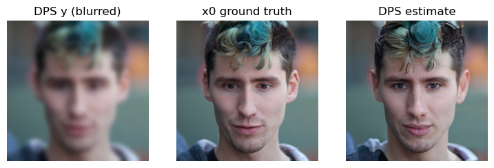

# Diffusion Posterior Sampling implementation

My implementation study of **Diffusion Posterior Sampling (DPS)** for image deblurring, started as MP3 for **ECE 498/598 Deep Generative Models at UIUC (Fall 2025)**.

The idea comes from [Diffusion Posterior Sampling for General Noisy Inverse Problems](https://arxiv.org/abs/2209.14687) by Chung et al. A pretrained diffusion model gives a prior for what an image should look like, while measurement guidance nudges each reverse step toward the observed image. Here, the observation is a Gaussian-blurred face with optional Gaussian noise.

The code is organized around the paper's clean-image estimate and posterior-guided reverse sampling. The residual-norm guidance follows the [authors' Gaussian-noise implementation](https://github.com/DPS2022/diffusion-posterior-sampling/blob/main/guided_diffusion/condition_methods.py). This is a small implementation study with its own choices, rather than a reproduction of all the paper's experiments.

## What's here

- A pretrained FFHQ UNet that predicts noise and learned-range variance.
- A differentiable Gaussian blur operator.
- DDPM reverse proposals followed by measurement guidance, with gradients through the denoiser and clean-image estimate.
- A short notebook and command-line runner with a seed, timestep respacing, and saved run settings.
- CPU checks for gradients, reverse sampling, and timestep mapping.

```text
dps.ipynb        # short walkthrough
dps/
  sampling.py   # posterior guidance and reverse sampling
  diffusion.py  # schedule, variance, and timestep respacing
  operators.py  # Gaussian measurement operator
  model.py      # pretrained UNet loading
  images.py     # image conversion
vendor/         # guided-diffusion code and its license
assets/         # saved original notebook example
docs/           # running notes and archived-output details
```

## Original notebook example



This figure is saved output from the original course notebook, which used a simplified residual correction. It is **not a result from the current sampler**. The exact execution settings and seed weren't recorded, and there are no saved PSNR or SSIM measurements. [docs/archived_result.json](docs/archived_result.json) records the source and hashes.

The current code uses guidance through the denoiser, learned reverse variance, and a correction after the reverse proposal. Those changes affect reconstruction results. [docs/RUNNING.md](docs/RUNNING.md) has setup instructions and the implementation details.

## Credit

Thank you to **Professor Romit Roy Choudhary and the ECE 498/598 Deep Generative Models course staff at UIUC** for the assignment and template code, including model setup, the blur operator, image handling, and the original sampling framework. My original assignment work completed the DPS utility formulas and used the provided tuning controls; this repo reorganizes and extends that starting point.

The method comes from [Chung et al.](https://arxiv.org/abs/2209.14687), and the [official DPS repository](https://github.com/DPS2022/diffusion-posterior-sampling) is the reference for the posterior-guidance implementation and pretrained checkpoint. The UNet and diffusion utilities come from [OpenAI's guided-diffusion](https://github.com/openai/guided-diffusion), with its MIT license preserved in [vendor/LICENSE](vendor/LICENSE). The project also uses PyTorch, NumPy, Pillow, and tqdm.

I used ChatGPT Sol to help organize and clean up the code, write documentation, align posterior guidance with the reference implementation, and add numerical checks.
